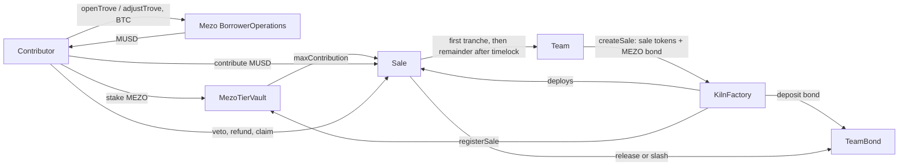

# Kiln

Borrow to participate. Join token sales by borrowing MUSD against your BTC on Mezo, without selling the BTC.

Kiln is a launchpad on Mezo testnet. Sales raise MUSD. Contributors get higher per-wallet caps by staking MEZO. Teams post a MEZO bond that is slashed to contributors if they veto the team. Two sales have run end to end on testnet, see [Transaction proofs](#transaction-proofs).

## Problem

BTC holders who want early access to new projects usually have to sell BTC or move it to another chain to buy into a sale. On the other side, token sales often reward whoever is fastest or richest, and teams can take the money with nothing at stake.

## Design

1. **Borrow to participate.** A contributor opens a trove on Mezo (or tops up an existing one) to borrow MUSD against BTC, then contributes the MUSD to a sale. The trove belongs to the contributor. Kiln never holds trove collateral.
2. **MEZO stake tiers.** Every wallet gets a base cap. Staking MEZO in `MezoTierVault` raises it, up to a ceiling. Stake stays locked while the wallet has a contribution in an unsettled sale.
3. **MEZO team bond.** The team posts MEZO to `TeamBond` when it creates a sale. The bond returns to the team if the sale fails or the timelock passes with no veto. If contributors holding enough of the raise veto, the bond is slashed to them pro rata.
4. **Staged release.** If the soft cap is met, the team gets a first tranche at finalize and the remainder after a timelock. During the timelock, contributors can veto. A passed veto refunds the unreleased remainder pro rata.

## Architecture



`KilnFactory` has no owner. It creates sales inside fixed parameter bounds set at deployment. The vault has an owner who can only tune the cap curve, never touch stakes. `Sale` and `TeamBond` have no admin path.

## How MUSD and MEZO are used

| Asset | Role |
|---|---|
| **MUSD** | The raise token. Contributors borrow it from Mezo against BTC and contribute it to a sale. Raised MUSD is paid to the team in two tranches. |
| **MEZO** | Staked in `MezoTierVault` to raise a wallet's cap. Also the team bond in `TeamBond`. |

Staked MEZO and bonds are plain MEZO balances, not veMEZO. See [What's planned](#whats-planned).

## What's built

All of this is merged to `main`.

**Contracts** (`contracts/src`, Foundry, Solidity 0.8.24): `KilnFactory`, `Sale`, `MezoTierVault`, `TeamBond`, plus a `DemoToken` used for the testnet sales.
- Sale lifecycle: contribute, refund on a missed soft cap, finalize with a first tranche, claim tokens, veto during a timelock, veto refund, release of the remainder, team reclaim after a failed sale.
- Deployed to Mezo testnet. Both a successful sale and a failed sale have run live.
- Tests: 95 pass and 1 is skipped (the testnet fork test, which needs `MEZO_TESTNET_RPC_URL`). Includes fuzz tests and an invariant suite. Details in [docs/security.md](docs/security.md).

**Frontend** (`web/`, Next 14, React 18, wagmi 2, anime.js): pages to browse sales, create a sale, participate (borrow, stake, contribute), and view a position. Mezo Passport 0.17.2 is integrated. A viem client in `web/lib/kiln-chain.ts` talks to the contracts. `web/scripts/fork-e2e.ts` runs that client through the whole flow on an anvil fork.

**Mezo verification** (`scripts/`, [docs/mezo-verified.md](docs/mezo-verified.md)): live checks of MEZO approve, `transferFrom` and permit, a real `openTrove` on testnet, and trove position reads.

### What has not been tested

- **The veto path has not run live.** It is covered by unit and invariant tests only.
- **No sale on testnet has had more than one contributor.**
- **Passport smart-account wallets are untested**, including MEZO `transferFrom` from a smart account. The Passport integration has not been tried with a real Bitcoin wallet.
- **Borrowing is not part of the sale proof.** The live sales used a contributor wallet that was funded with MUSD by a transfer. A real `openTrove` on testnet is documented separately ([docs/mezo-verified.md](docs/mezo-verified.md), section B), from a different wallet and a script, not through the Kiln UI.
- The unit tests use a mock ERC-20 for MEZO because forge cannot execute it. MEZO behaviour is proven by the live transactions.
- The frontend is not deployed anywhere. There is no hosted demo URL.

## What's planned

None of this is in the repo.

- **Liquidity seeding.** At finalize, send a share of the raise and sale tokens into a Mezo Pools volatile pool, with LP tokens in a timelock.
- **One-transaction signature borrow.** Mezo's `BorrowerOperationsSignatures.openTroveWithSignature` would let a contributor sign once and borrow and contribute in a single transaction. Today borrowing and contributing are separate steps.
- **veMEZO gating** once a veMEZO testnet address is confirmed. The research found none. Tiers use staked MEZO until then.
- **Fixing the veto incentive.** See [Security notes](#security-notes).

## Local setup

Prerequisites: [Foundry](https://book.getfoundry.sh/) and Node.js.

```bash
git clone https://github.com/embolaweb3/kiln && cd kiln

# contracts
cd contracts
forge build
forge test        # 95 pass, 1 skipped without MEZO_TESTNET_RPC_URL

# web
cd ../web
cp .env.example .env.local
npm install
npm run dev
```

`npm run dev` first runs `npm run sync`, which copies the contract ABIs and `contracts/deployments/testnet.json` into the app. `NEXT_PUBLIC_USE_FIXTURES=true` (the `.env.example` default) serves sales from local fixtures, while Mezo position reads and borrowing still go to testnet. Set it to `false` to read the deployed contracts. `NEXT_PUBLIC_WC_PROJECT_ID` is only needed for the WalletConnect flow. See `web/README.md`.

Not re-run for this README: `npm install` and `npm run dev`. `forge test` was run on 2026-11-19.

## Testnet addresses

Mezo testnet, chain ID `31611`, RPC `https://rpc.test.mezo.org`, explorer `https://explorer.test.mezo.org`.

### Kiln

From `contracts/deployments/testnet.json`, deployed at block 16790940.

| Contract | Address |
|---|---|
| KilnFactory | [`0xF2ffCF1c35A1b597932be0f2349b9c7B35Ab3ffb`](https://explorer.test.mezo.org/address/0xF2ffCF1c35A1b597932be0f2349b9c7B35Ab3ffb) |
| MezoTierVault | [`0x652c5c4637656EB18079594A7e5B0d9De7E7Faa3`](https://explorer.test.mezo.org/address/0x652c5c4637656EB18079594A7e5B0d9De7E7Faa3) |
| TeamBond | [`0x6B1cDFfa339268978bcaC8E85D69c5FC653a4C13`](https://explorer.test.mezo.org/address/0x6B1cDFfa339268978bcaC8E85D69c5FC653a4C13) |
| Sale A (EMBR, succeeded) | [`0x3721FD15543fC4Bd43AAF951eF87B231576ab384`](https://explorer.test.mezo.org/address/0x3721FD15543fC4Bd43AAF951eF87B231576ab384) |
| Sale B (TIDE, failed) | [`0x46137370fa5612933c8638c41Bcb3bB154D8009B`](https://explorer.test.mezo.org/address/0x46137370fa5612933c8638c41Bcb3bB154D8009B) |
| EMBR (demo token) | [`0xaca1B07a18f0a6b3B96232A4F4028BaAf7c59F5f`](https://explorer.test.mezo.org/address/0xaca1B07a18f0a6b3B96232A4F4028BaAf7c59F5f) |
| TIDE (demo token) | [`0x265CeB3A2E12daB9cf795204cDABF2F52B05940d`](https://explorer.test.mezo.org/address/0x265CeB3A2E12daB9cf795204cDABF2F52B05940d) |

Factory bounds: duration 10 minutes to 30 days, timelock 5 minutes to 14 days, veto threshold 5% to 50% of the raise, first tranche at most 50%, soft cap at least 20% of the hard cap, minimum bond 1 MEZO. The cap curve is 500 MUSD base plus 100 MUSD per staked MEZO, at most 5,000 MUSD.

### Mezo contracts used

| Contract | Address |
|---|---|
| MUSD | `0x118917a40FAF1CD7a13dB0Ef56C86De7973Ac503` |
| MEZO | `0x7B7c000000000000000000000000000000000001` |
| BorrowerOperations | `0xCdF7028ceAB81fA0C6971208e83fa7872994beE5` |

## Transaction proofs

The full log, with every transaction and the checks run after each phase, is in [docs/testnet-proof.md](docs/testnet-proof.md). The run was on 2026-11-15. Two sales ran in parallel from one factory, with one contributor.

| Step | Transaction |
|---|---|
| Create sale A (EMBR, soft cap 100 MUSD) | [`0xae8c150b…`](https://explorer.test.mezo.org/tx/0xae8c150b5522bf07ddd219135a95c8c3a5d7794713be41185be2454d07ec90c9) |
| Create sale B (TIDE, soft cap 100 MUSD) | [`0x55025e76…`](https://explorer.test.mezo.org/tx/0x55025e76e242784c1c3e6ee4b9567781ee78aad03a587cb75a54ee0e9e6dae77) |
| Stake 2 MEZO (cap goes from 500 to 700 MUSD) | [`0xda61c86c…`](https://explorer.test.mezo.org/tx/0xda61c86cefb414600fa1caf171ed578b2f9181535a034ff2fdedcd41893cee3f) |
| Contribute 150 MUSD to A | [`0xbb9b38fc…`](https://explorer.test.mezo.org/tx/0xbb9b38fc9df3359127b57edd8608752ba21648604e5a2639b8487bcda80dd600) |
| Contribute 30 MUSD to B | [`0xf01eb4a6…`](https://explorer.test.mezo.org/tx/0xf01eb4a69422c63759d2dc4a569e1c354ba902adb248ec2ab4751d8875b9feb3) |
| Finalize A, first tranche 37.5 MUSD to the team | [`0x2ae0deec…`](https://explorer.test.mezo.org/tx/0x2ae0deec4b0404e508536d122640a1d29e021bc79255d6320e1193c04c3d07c4) |
| Claim 150 EMBR | [`0xc277e06a…`](https://explorer.test.mezo.org/tx/0xc277e06aba21ae7629e01e7dff5feed3bbe825c4509aef617ebd1ad913e2a16e) |
| Refund 30 MUSD from B | [`0x0738b87b…`](https://explorer.test.mezo.org/tx/0x0738b87b75d67342bdba272939d3e9961efa3b80fe9fe1fccc9bf2c42e684e42) |
| Team reclaims B's tokens and bond | [`0x7bb61ee3…`](https://explorer.test.mezo.org/tx/0x7bb61ee3b70888507db69ba5fd4e139e0d39f38415ff427096b76bebc26acf05) |
| Unstake 2 MEZO | [`0x47b7fdd9…`](https://explorer.test.mezo.org/tx/0x47b7fdd90d98bbbd532630762d71551485a4bf7f3d1aeaddbf6efe4a4d5e6426) |
| Release A's remainder (112.5 MUSD) and return the bond | [`0x73c8f29a…`](https://explorer.test.mezo.org/tx/0x73c8f29ac3610bdc9a1488eeb1000c4981633cea184b250360484845054cff74) |

Honest notes on the run, also in the proof doc: it took three attempts of the end-to-end script, because of script bugs and not contract changes. Two contributor approvals were sent by hand and are labelled as such. The trove proof is separate: a real `openTrove` on testnet is [`0x5526ba41…`](https://explorer.test.mezo.org/tx/0x5526ba41ecbf9a85cfcaf2e45f88cced4203aaedffcba57c94d810d4a6b81e9b).

## Security notes

Full detail is in [docs/security.md](docs/security.md).

- **Slither 0.11.6** found a missing zero-address check (fixed, with tests) and timestamp comparisons (accepted, since sale windows are at least minutes). No audit has been done.
- **Invariant tests**, mutation-checked, cover raise accounting, wallet caps, stake locked while a contribution is live, and the bond staying put while a veto is possible.
- **No admin path to user funds.** The factory, sale and bond have no owner. The vault owner can only change the cap curve, within a fixed ceiling.
- **Fee-on-transfer tokens** are rejected with balance-delta checks.
- **Known issue: a veto can be profitable.** A veto refunds the unreleased MUSD and slashes the bond, but tokens are claimable right after finalize. A holder at the veto threshold can veto, keep the tokens, and pay only for the released share of the price. The planned fix is to hold token claims until the timelock ends. It is not in this build.
- **Refunds do not unwind debt.** A failed-sale refund returns MUSD, but the contributor still owes the trove's principal, interest and fee.
- **Liquidation and redemption risk stays with the user.** A trove liquidates at 110% ICR. The participate page shows the ratio and warns below 150%.
- **Minimum borrow is 1,800 MUSD net debt** when opening a trove.
- MEZO is a precompile-backed token, so unit tests mock it and the real behaviour is proven live.

## License

MIT
