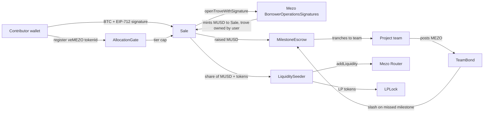

# Kiln

Borrow to participate. Join token sales by borrowing MUSD against your BTC on Mezo, without selling the BTC.

> **Status:** design phase. Contracts, deployments and the UI are being built on separate branches. Sections marked *pending* are filled in only once the code is merged and working. See [What's built](#whats-built).

## Problem

BTC holders who want early access to new projects usually have to sell BTC or bridge it out to buy into a sale. That means losing exposure, taking a taxable event, and moving funds to chains where they are less safe. On the other side, token sales often reward whoever is fastest or richest, and teams can raise money and walk away with no cost to them.

## Design

Kiln is a launchpad built around Mezo's own primitives.

1. **Borrow to participate.** A contributor borrows MUSD against BTC on Mezo and uses it to join a sale. The BTC stays locked in the contributor's own trove.
2. **MEZO stake tiers.** Allocation tiers come from MEZO stake (veMEZO), so long-term Mezo participants get larger caps.
3. **MEZO team bond.** A project team posts MEZO as a quality bond. If it misses its milestones, the bond can be slashed for contributors.

### Why the trove stays with the user

A Mezo trove belongs to `msg.sender`, one per address. If a sale contract opened troves, Kiln would own them. Kiln never holds trove collateral. The design instead uses `BorrowerOperationsSignatures.openTroveWithSignature`, where the user is the borrower and the sale contract is only the MUSD recipient. Details and sources are in [docs/mezo-integration.md](docs/mezo-integration.md).

## Architecture

The diagram shows the **target** design. Not every box is built yet.



## How MUSD and MEZO are used

| Asset | Role in Kiln |
|---|---|
| **MUSD** | The only currency a sale accepts. Contributors borrow it against BTC. Raised MUSD sits in milestone escrow and part of it seeds liquidity. |
| **MEZO** | Sets allocation tiers (veMEZO weight at a snapshot) and backs the team quality bond (plain MEZO in a Kiln-owned escrow). |

veMEZO cannot be the bond itself because a locked veMEZO NFT has no slashing hook. The bond is held as plain MEZO instead.

## What's built

Only what is merged to `main` and working is listed here.

- Repo scaffolding: Foundry project, Next.js app with wagmi, viem and anime.js.
- Mezo integration research with sources: [docs/mezo-integration.md](docs/mezo-integration.md).

*Contracts, tests, frontend and deployments: pending. This section is updated when they merge.*

## What's planned

- Liquidity seeding: at finalize, a share of raised MUSD plus project tokens goes into a Mezo Pools volatile pool, with LP tokens sent to a timelock.
- One-transaction signature borrow: sign `OpenTrove` once, then send a single transaction that borrows and contributes. This works for EOA wallets. Passport Bitcoin wallets use a two-step flow because the signature path is ECDSA only.
- veMEZO gating once a testnet veMEZO address is confirmed. Until then the fallback is veBTC or a clearly labelled stand-in.

## Local setup

Prerequisites: [Foundry](https://book.getfoundry.sh/), Node.js.

```bash
git clone <repo-url> && cd kiln

# contracts
cd contracts
forge build
forge test

# web
cd ../web
npm install
npm run dev
```

*Pending verification against the final repo. Contract commands will be re-checked once contracts land, and environment variables will be listed here.*

## Mezo testnet

| Item | Value |
|---|---|
| Chain ID | `31611` |
| RPC | `https://rpc.test.mezo.org` |
| Explorer | `https://explorer.test.mezo.org` |
| Faucet | `https://faucet.test.mezo.org` (testnet BTC only, MUSD must be borrowed) |

Mezo protocol addresses Kiln integrates with (read from chain on 2026-11-14, see the research notes):

| Contract | Address |
|---|---|
| MUSD | `0x118917a40FAF1CD7a13dB0Ef56C86De7973Ac503` |
| BorrowerOperations | `0xCdF7028ceAB81fA0C6971208e83fa7872994beE5` |
| BorrowerOperationsSignatures | `0xD757e3646AF370b15f32EB557F0F8380Df7D639e` |
| MEZO | `0x7B7c000000000000000000000000000000000001` |
| Router | `0x9a1ff7FE3a0F69959A3fBa1F1e5ee18e1A9CD7E9` |

### Kiln deployments

*Pending. No Kiln contract is deployed yet.*

| Contract | Address |
|---|---|
| Sale / Factory | pending |
| AllocationGate | pending |
| TeamBond | pending |
| MilestoneEscrow | pending |
| LiquiditySeeder | pending |

## Transaction proofs

*Pending. Explorer links to a real borrow-and-contribute flow, a bond post and a refund or slash will be added after they run on testnet.*

## Security notes

Known properties of the design, from the Mezo research:

- Kiln never holds trove collateral. The user owns the trove.
- **Refunds do not unwind debt.** If a sale fails and MUSD is refunded, the contributor still owes principal, interest and fee on the trove.
- **Liquidation and redemption risk stays with the user.** A trove is liquidated at 110% ICR and can be redeemed. The UI should push a collateral buffer and show ICR. Kiln cannot protect users from this.
- **Minimum net debt is 1,800 MUSD** (plus 200 MUSD gas compensation), so borrowing fresh is costly for small contributors. Sales should also accept existing MUSD.
- **veMEZO NFTs are transferable.** The gate must register each `tokenId` once against a past snapshot to stop one NFT being reused across wallets or flash-lent.
- MEZO has no burn function, so slashed MEZO goes to a treasury or refund pool.
- Signature borrow is ECDSA only, with a deadline and a per-borrower nonce.

*Audit, test coverage and fuzz results: pending. Nothing here claims the contracts are audited.*

## Known issues
- **A veto can be profitable.** Sale tokens stay claimable during the release timelock, so a holder at the veto threshold can veto, keep all their tokens, and get the unreleased MUSD back plus a share of the team bond. The planned fix is to hold token claims until the timelock ends. Not in the current build. Details in `docs/security.md`.

## License

MIT
